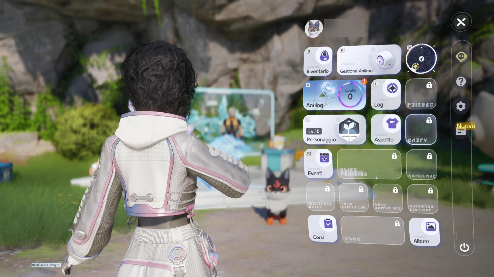
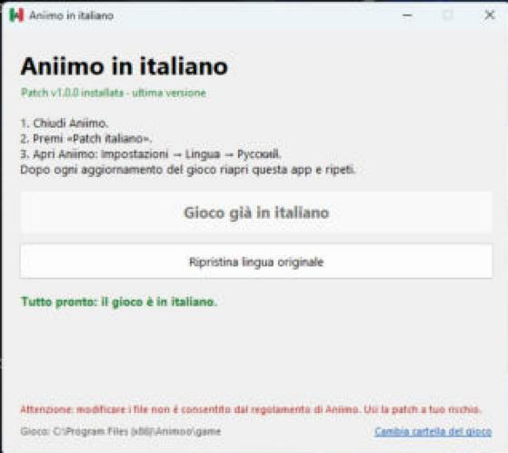
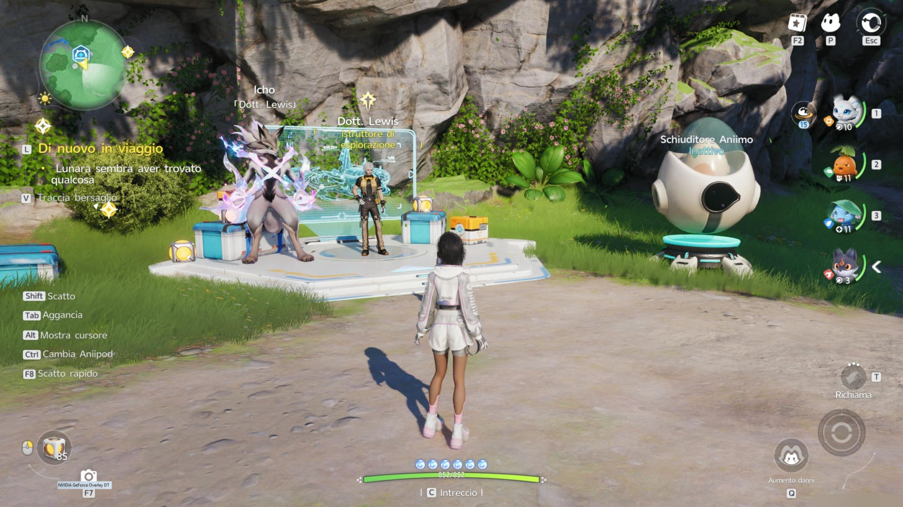
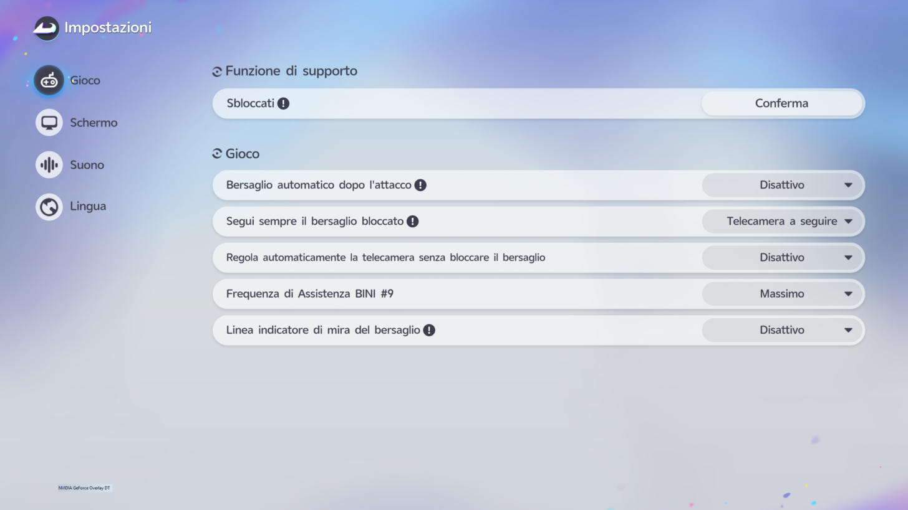
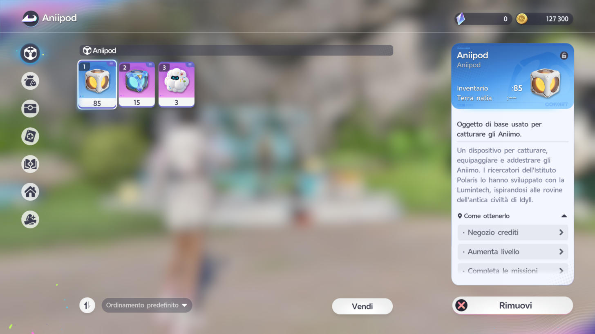

# Aniimo ITA

**Aniimo tutto in italiano**: menu, missioni, oggetti, dialoghi.
Traduzione amatoriale e non ufficiale, con un'app che fa tutto da sola.

> ⚠️ **Modificare i file del gioco non è consentito dal regolamento di Aniimo.**
> Usi la patch a tuo rischio. Leggi le [avvertenze](#avvertenze).

## Come si usa

1. **Scarica `AniimoITA.exe`** dalla sezione **[Releases](../../releases/latest)** (a destra nella pagina).
2. **Chiudi Aniimo** e apri `AniimoITA.exe`.
3. Premi **«Installa patch in italiano»** e rispondi **Sì** alla richiesta di Windows.
4. Apri Aniimo: **Impostazioni → Lingua → Русский**. Il gioco ora è in italiano.

Guida con le immagini: **[GUIDA.md](GUIDA.md)**.

## L'app

| Pulsante | Cosa fa |
|---|---|
| **Installa patch in italiano** | mette (o aggiorna) l'italiano nel gioco |
| **Ripristina lingua originale** | rimette i testi originali del gioco |

Quando apri l'app controlla da sola lo stato. La scritta piccola sotto il titolo mostra la versione della patch:
- 🟢 **verde** (es. «Patch v1.0.0 installata · ultima versione»): il pulsante diventa **«Ultima versione già installata»**
  e non serve fare niente;
- 🔴 **rossa** (es. «Nel gioco c'è la patch v1.0.0 · disponibile v1.0.1»): premi «Installa patch in italiano».

## Aggiornamenti

- **Il gioco si aggiorna?** Riapri l'app e premi «Installa patch in italiano». Fine.
- **La traduzione migliora?** L'app scarica da sola la versione nuova quando la apri. Non serve riscaricare l'exe.

Dettagli in **[AGGIORNAMENTI.md](AGGIORNAMENTI.md)**. Versioni e avanzamento: **[ROADMAP.md](ROADMAP.md)**.

## Com'è il gioco in italiano

| | |
|---|---|
|  |  |
|  |  |

Altre immagini nella cartella [`foto/`](foto/). Cosa è stato fatto finora: **[STORIA.md](STORIA.md)**.

## Sostieni il progetto

La traduzione è **gratuita** e lo resterà. Se ti è utile e vuoi aiutarmi a finire la revisione,
puoi offrirmi un caffè:

Le donazioni sono volontarie e non sbloccano niente: la patch è uguale per tutti.

## Avvertenze

- **Le modifiche ai file non sono accettate dal regolamento di Aniimo.** La patch cambia solo i testi
  (non è un cheat, non tocca gameplay, rete o anti-cheat), ma resta una modifica vietata dai termini di servizio.
  **Il rischio, fino alla sospensione dell'account, è tuo.**
- Progetto **non ufficiale**, senza legami con chi sviluppa o pubblica Aniimo. Marchi e testi originali
  appartengono ai rispettivi proprietari.
- **Uso personale.** Non ridistribuire la traduzione.
- Puoi tornare al gioco originale quando vuoi: pulsante **«Ripristina lingua originale»**, oppure
  "verifica/ripara file" nel launcher di Aniimo.

---

La cartella `sorgenti/` contiene il codice dell'app: non serve per giocare. I testi del gioco non sono inclusi.
